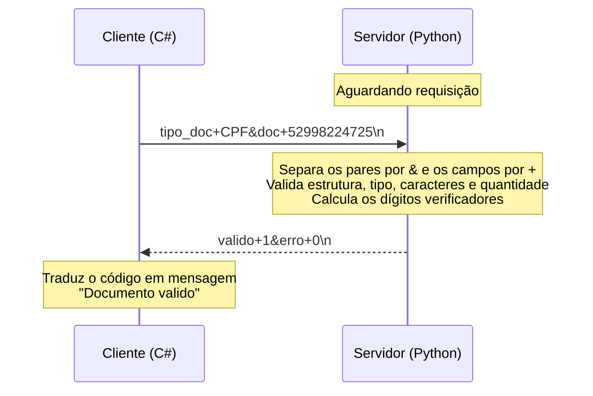

# GBProtocol: Validador de Documentos com Sockets

Validador de CPF e CNPJ implementado com **sockets TCP**, com servidor em **Python** e cliente em **C# (.NET)**.

Trabalho da disciplina de Sistemas Distribuídos. O GBProtocol é um protocolo de camada de aplicação próprio: as mensagens são texto ASCII no formato `campo+resposta`, com os pares separados por `&`. Existe também uma versão do mesmo protocolo feita com gRPC: [Validador-Documentos-Utilizando-GRPC](https://github.com/GabrielPontel/Validador-Documentos-Utilizando-GRPC).

## Como funciona

O servidor fica aguardando uma requisição. O cliente envia o tipo e o número do documento, o servidor separa os campos, aplica as regras de validação e devolve apenas códigos: se o documento é válido e, quando houver, o código do erro. O cliente traduz esses códigos em uma mensagem para o usuário.

```
Cliente  --- tipo_doc+CPF&doc+52998224725\n --->  Servidor
         <--- valido+1&erro+0\n -----------------
```

## Diagrama do protocolo



Em caso de erro, o fluxo é o mesmo e só muda a resposta, por exemplo `valido+0&erro+2.1` quando o tipo não é CPF nem CNPJ. Todos os códigos estão em [Códigos de resposta](#códigos-de-resposta).

## Diagrama de estados

<p align="center">
  
</p>

## Formato das mensagens

Toda mensagem é texto ASCII formado por pares `campo+resposta`: o nome do campo e o seu valor são separados por `+`, e cada par é separado do seguinte por `&`. Os pares são escritos em sequência, sem espaços, e a mensagem termina com `\n`, que indica ao outro lado que ela chegou inteira (o TCP é um fluxo de bytes, então uma leitura pode trazer só parte da mensagem). O `&` foi escolhido porque não aparece em CPF nem em CNPJ, mesmo quando digitados com máscara.

### Requisição

| Campo | Tipo | Descrição | Regra |
|---|---|---|---|
| `tipo_doc` | texto | Tipo de documento a validar | `CPF` ou `CNPJ`, em letras maiúsculas |
| `doc` | texto | Número do documento | Somente dígitos, sem pontos, traços ou barras |

Exemplo: `tipo_doc+CPF&doc+52998224725`

### Resposta

| Campo | Valores | Descrição |
|---|---|---|
| `valido` | 0 ou 1 | 1 se o documento é válido, 0 caso contrário |
| `erro` | código (ex.: 1.2) | 0 quando não houve erro; caso contrário, o código do erro |

Exemplo: `valido+1&erro+0`

O servidor devolve apenas códigos. A tradução para texto é feita pelo cliente, que também calcula os detalhes (quantos dígitos faltam ou sobram e quais caracteres foram rejeitados) a partir do documento que ele mesmo enviou.

### Códigos de resposta

A parte inteira do código identifica a família do problema.

| valido | erro | Significado |
|---|---|---|
| 1 | 0 | Documento válido |
| 0 | 0 | Formato correto, mas os dígitos verificadores não conferem |
| 0 | 1.1 | Estrutura da requisição inválida |
| 0 | 1.2 | Campo `tipo_doc` não informado ou vazio |
| 0 | 1.3 | Campo `doc` não informado ou vazio |
| 0 | 2.1 | Tipo de documento não reconhecido pelo protocolo |
| 0 | 3.1 | Quantidade de dígitos menor que a esperada |
| 0 | 3.2 | Quantidade de dígitos maior que a esperada |
| 0 | 4.1 | Campo `doc` contém caracteres que não são dígitos |

Um campo ausente e um campo presente com valor vazio recebem o mesmo código. São tratados como erro de estrutura (1.1): mensagem vazia, par sem o caractere `+`, campo desconhecido, campo repetido e requisição que não chega completa em 10 segundos.

## Estrutura do projeto

```
.
├── servidor_gbprotocol.py
├── Diagrama de Estados - GBProtocol.png
└── GBProtocol/
    ├── GBProtocol.slnx
    └── GBProtocol/
        ├── GBProtocol.csproj
        └── Program.cs
```

## Pré-requisitos

- Python 3.7 ou superior (só biblioteca padrão)
- .NET SDK 10

## Como executar

### Servidor (Python)

```powershell
python servidor_gbprotocol.py
```

Saída esperada:

```
GBProtocol ouvindo em 0.0.0.0:4851 (max. 10 conexoes)
```

Deixe esse terminal aberto. Para encerrar o servidor, use `Ctrl+C`.

### Cliente (C#)

Em outro terminal:

```powershell
cd GBProtocol\GBProtocol
dotnet run
```

Ou abra `GBProtocol.slnx` no Visual Studio e execute.

Exemplo de uso:

```
Tipo do documento (CPF/CNPJ) (Somente aperte enter para sair): CPF
Numero do documento (somente digitos): 52998224725

REQUISICAO:
tipo_doc+CPF&doc+52998224725

RESPOSTA:
valido+1&erro+0

RESULTADO:
Documento valido
```

```
Tipo do documento (CPF/CNPJ) (Somente aperte enter para sair): CNPJ
Numero do documento (somente digitos): 11.222.333/0001-81

REQUISICAO:
tipo_doc+CNPJ&doc+11.222.333/0001-81

RESPOSTA:
valido+0&erro+4.1

RESULTADO:
O campo doc so aceita digitos e os caracteres ., / e - nao sao permitidos
```

Também dá para testar o servidor sem o cliente, por exemplo com `ncat localhost 4851` e digitando a requisição.

## Documentos para teste

| Tipo | Número | Resultado |
|---|---|---|
| CPF | 52998224725 | válido |
| CPF | 52998224726 | inválido |
| CNPJ | 11222333000181 | válido |
| CNPJ | 11222333000180 | inválido |

## Comparação com a versão gRPC

| Aspecto | Sockets (este repositório) | gRPC |
|---|---|---|
| Transporte | TCP, porta 4851 | HTTP/2 sobre TCP, porta 4851 |
| Formato da mensagem | Texto `campo+resposta&...` terminado em `\n` | Protocol Buffers definido no `.proto` |
| Leitura da requisição | Feita à mão: separa por `&` e por `+` | Gerada a partir do `.proto` |
| Códigos de erro | Os mesmos | Os mesmos |
| Linguagens | Servidor em Python, cliente em C# | Servidor em Python, cliente em Node.js |

## Referências

- [Python: socket — Low-level networking interface](https://docs.python.org/3/library/socket.html)
- [.NET: TcpClient](https://learn.microsoft.com/dotnet/api/system.net.sockets.tcpclient)

## Autor

Gabriel Pontel de Mori
